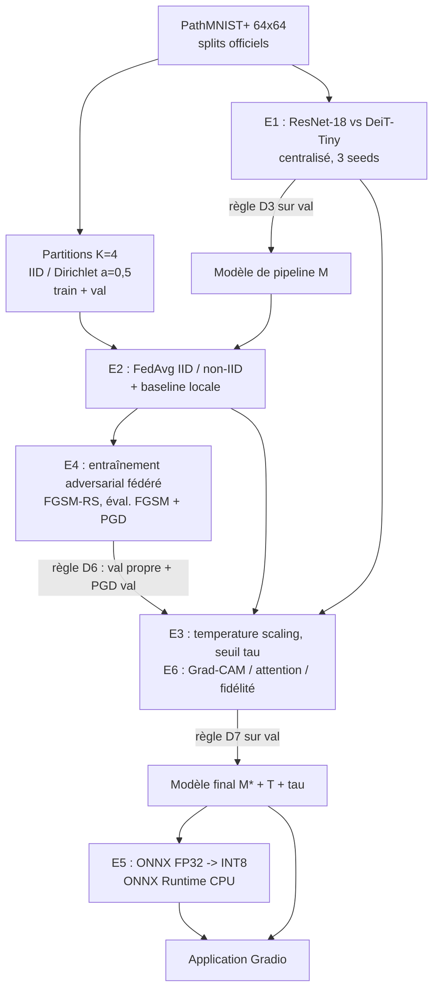

# MediTrust — Cahier des charges

**Version :** 0.3 (v0.2 approuvée le 22/11/2026 ; clarification de D6 : alertes FGSM/PGD investiguées par PGD renforcé, sans rejet automatique)
**Date :** 21 novembre 2026
**Statut :** PHASE 0 — À VALIDER. Aucune décision technique de ce document n'est approuvée tant que la section 22 n'a pas été validée.

Documents associés : `PROTOCOLE_EXPERIMENTAL.md` (expériences détaillées), `ROADMAP.md` (phases), `PROJECT_STATUS.md` (suivi).

---

## 1. Identification du projet

| Élément | Valeur |
|---|---|
| Nom | MediTrust |
| Titre complet | MediTrust — A Trustworthy Medical AI Pipeline Integrating Federated Learning, Confidence Calibration, Adversarial Robustness, Explainability, and Edge Deployment |
| Étudiant | Anasse Harki |
| Établissement | École Nationale des Sciences Appliquées de Fès (ENSA Fès), Maroc |
| Filière | 3IACN — Informatique, Intelligence Artificielle et Confiance Numérique (dernière année) |
| Module | Intelligence Artificielle Avancée (Pr. Oussama El Gannour), A.U. 2026/2027 |
| Répertoire local | `C:\Users\harki\Downloads\MediTrust` |
| Dépôt prévu | `github.com/An4ss3/MediTrust` (non créé, création soumise à approbation) |
| Nature | Prototype de recherche académique. Ce n'est pas un dispositif médical et il n'a aucune validation clinique. |

## 2. Contexte académique

Le projet, approuvé par l'enseignant, doit intégrer au moins six thèmes avancés de la liste officielle du module (« Liste des thèmes : Directives de préparation », V2, 7 octobre 2026) dans un pipeline unique et cohérent.

Exigences de l'enseignant reprises comme contraintes du projet :

1. Problème réel et pertinent.
2. Au moins six techniques avancées, chacune justifiée.
3. Techniques complémentaires et non juxtaposées.
4. Données réelles et publiques.
5. Implémentation, entraînement, évaluation et comparaison.
6. Méthodologie expérimentale rigoureuse.
7. Résultats mesurables et reproductibles.
8. Faisabilité dans les contraintes académiques.

Contraintes extraites de la liste officielle des thèmes, applicables à MediTrust :

- Démonstrations réalisables sur Google Colab, sans matériel physique obligatoire (pas de GPU local, ESP32 ou Raspberry Pi).
- Pas d'entraînement long de grands modèles. On privilégie les modèles compacts pré-entraînés, le fine-tuning léger et la simulation.
- Notebooks exécutables depuis une session vierge, qui installent les bibliothèques et indiquent les versions, le dataset, le modèle, le besoin CPU/GPU, le temps d'exécution et la mémoire approximative.
- Fédéré : il s'agit d'une simulation dans Colab, et non d'un déploiement multi-machines (Thème 10).
- Edge : le déploiement est simulé par conversion, quantification et inférence avec un runtime léger (Thème 12).

## 3. Problématique

Un classifieur d'images histopathologiques doit être performant, mais aussi digne de confiance selon plusieurs dimensions qui interagissent :

| Dimension | Problème | Question opérationnelle |
|---|---|---|
| Performance | Choix d'architecture (CNN ou ViT) sous contrainte de calcul | Quelle architecture légère est adaptée ? |
| Décentralisation | Les établissements ne peuvent pas toujours partager leurs images | Peut-on entraîner un modèle partagé sans centraliser les images ? |
| Fiabilité | Un réseau peut se tromper avec une confiance élevée | La confiance affichée est-elle calibrée ? Quand faut-il demander une revue experte ? |
| Robustesse | De petites perturbations peuvent changer la prédiction | Quelle est la vulnérabilité et l'entraînement adversarial la réduit-il ? |
| Interprétabilité | Les décisions doivent pouvoir être examinées | Quelles visualisations sont adaptées au CNN et au ViT, et sont-elles fidèles ? |
| Efficacité | Les modèles doivent tourner sur du matériel contraint | Que coûte la quantification INT8 en précision et en calibration ? |

Ces dimensions ne sont pas indépendantes. L'entraînement fédéré non-IID peut dégrader la calibration, l'entraînement adversarial modifie la confiance et les cartes d'explication, et la quantification peut modifier les probabilités. MediTrust mesure ces interactions sur un même modèle qui traverse le pipeline.

## 4. Objectif général

Concevoir, entraîner et évaluer un pipeline unique de classification de tissus colorectaux (PathMNIST, 9 classes) dans lequel un même modèle est successivement :

1. choisi par comparaison CNN/ViT ;
2. entraîné de façon fédérée entre établissements simulés ;
3. durci par entraînement adversarial fédéré ;
4. calibré et doté d'un seuil de revue experte ;
5. expliqué par des méthodes adaptées à son architecture ;
6. quantifié pour l'inférence CPU ;
7. exposé dans une application Gradio de démonstration.

Le pipeline produit, à chaque étape, des mesures quantitatives des six dimensions de confiance.

## 5. Objectifs spécifiques

| ID | Objectif spécifique | Thème | Expérience |
|---|---|---|---|
| OS1 | Comparer ResNet-18 et DeiT-Tiny pré-entraînés en centralisé, à protocole identique | T4 | E1 |
| OS2 | Analyser le mécanisme d'attention du ViT (Q, K, V, cartes par tête, rollout, entropie) | T1 | E6 |
| OS3 | Comparer centralisé, FedAvg IID et FedAvg non-IID, avec une baseline locale | T10 | E2 |
| OS4 | Mesurer et corriger la calibration (temperature scaling) et définir un seuil de revue experte | T9 | E3 |
| OS5 | Produire et évaluer des explications (Grad-CAM, attention rollout) avec un test de fidélité et un sanity check | T9, T1 | E6 |
| OS6 | Mesurer la vulnérabilité FGSM/PGD et l'effet d'un entraînement adversarial fédéré | T11 | E4 |
| OS7 | Comparer l'inférence FP32 et INT8 sous ONNX Runtime à conditions égales | T12 | E5 |
| OS8 | Intégrer le modèle final dans une application Gradio minimale | Tous | Phase 7 |
| OS9 (optionnel) | Mesurer l'oubli catastrophique et l'effet d'EWC lors d'un transfert séquentiel entre établissements | T13 | E7 |

## 6. Questions de recherche

- **QR0 (transversale)** : Quels compromis apparaissent entre performance, décentralisation, calibration, robustesse, interprétabilité et efficacité lorsqu'un même modèle traverse le pipeline ?
- **QR1 (T4)** : Sur PathMNIST à 64×64, un ViT léger pré-entraîné (DeiT-Tiny) atteint-il une performance comparable à un CNN pré-entraîné (ResNet-18), et à quel coût ?
- **QR2 (T10)** : Quel écart de performance FedAvg présente-t-il par rapport au centralisé en IID et en non-IID (label skew) ? Fait-il mieux qu'un entraînement local isolé ?
- **QR3 (T9)** : Le temperature scaling ajusté sur la validation réduit-il l'erreur de calibration, et cet effet se transfère-t-il au test, qui provient de patients différents ?
- **QR4 (T11)** : Quelle est la vulnérabilité du modèle à FGSM et PGD selon ε ? L'entraînement adversarial fédéré l'améliore-t-il, et à quel coût en précision propre et en calibration ?
- **QR5 (T12)** : Quels gains de taille et de latence la quantification INT8 apporte-t-elle selon l'architecture, et quelles pertes en précision, en accord avec le modèle FP32 et en calibration ?
- **QR6 (T1, T9)** : Les cartes Grad-CAM et d'attention rollout sont-elles fidèles (test de suppression) et sensibles aux poids (sanity check) ? Comment évoluent-elles le long du pipeline ?
- **QR7 (T13, optionnelle)** : Lors d'une adaptation séquentielle à un nouvel établissement, EWC réduit-il l'oubli par rapport au fine-tuning naïf ?

## 7. Jeu de données PathMNIST

### 7.1 Faits vérifiés (sources officielles, consultées le 21/11/2026)

| Élément | Valeur | Source |
|---|---|---|
| Effectifs | train 89 996, val 10 004, test 7 180 (total 107 180) | `medmnist/info.py` (dépôt officiel) |
| Classes (9) | 0 adipose, 1 background, 2 debris, 3 lymphocytes, 4 mucus, 5 smooth muscle, 6 normal colon mucosa, 7 cancer-associated stroma, 8 colorectal adenocarcinoma epithelium | `medmnist/info.py` |
| Source train/val | NCT-CRC-HE-100K : 100 000 patches H&E 224×224 à 0,5 µm/px, normalisés par la méthode de Macenko, extraits de 86 lames (NCT Biobank et UMM Mannheim) | Zenodo 10.5281/zenodo.1214456 |
| Source test | CRC-VAL-HE-7K : 7 180 patches de 50 patients, sans recouvrement de patients avec NCT-CRC-HE-100K | Zenodo 10.5281/zenodo.1214456 |
| Découpage | NCT-CRC-HE-100K découpé aléatoirement en train/val (ratio 9:1) ; CRC-VAL-HE-7K sert de test | Yang et al., 2023 |
| Équilibre | Classes « seulement approximativement équilibrées ». Les auteurs recommandent de ne pas évaluer sur la seule accuracy | Zenodo 1214456 |
| Format | `.npz` uint8 à 6 clés (`{train,val,test}_{images,labels}`), sans identifiant de lame ni de patient | README officiel |
| MedMNIST+ | Tailles 28, 64, 128 et 224. Pour PathMNIST, 224 correspond aux images sources ; 64 et 128 sont redimensionnées depuis 224 ; mêmes splits et mêmes indices | `on_medmnist_plus.md` |
| Licence | CC BY 4.0 (attribution obligatoire). Le dataset n'est pas destiné à un usage clinique | README, Zenodo 10.5281/zenodo.10519652 |
| Benchmarks officiels (test) | ResNet-18 (28) : AUC 0,983 / ACC 0,907 ; ResNet-18 (224) : 0,989 / 0,909 ; ResNet-50 (28) : 0,990 / 0,911 ; ResNet-50 (224) : 0,989 / 0,892 | medmnist.com |

Point méthodologique important : la validation est tirée aléatoirement, au niveau patch, des mêmes 86 lames que le train. Elle est donc fortement corrélée au train et vraisemblablement optimiste. Le test provient d'autres patients et constitue un décalage de distribution réel. Ce fait conditionne la sélection de modèle (section 16, D3), la calibration (E3) et le seuil de revue experte (D7). La comparaison entre validation et test fera partie des résultats.

### 7.2 Choix de la résolution

| Taille | Téléchargement (Zenodo) | Mémoire uint8 non compressée (107 180 images, calculée) | Évaluation |
|---|---|---|---|
| 28×28 | 205,6 Mo | 0,25 Go | Incompatible avec un ViT à patchs 16×16 (moins de 2×2 patchs). Cartes d'explication inexploitables. |
| **64×64** | **1,1 Go** | **1,32 Go** | **Recommandée.** Tient en RAM Colab et en VRAM. Coût de stockage Drive faible. |
| 128×128 | 4,3 Go | 5,27 Go | Faisable mais lourde à recharger à chaque session. Gain attendu faible. |
| 224×224 | 12,6 Go | 16,1 Go | Dépasse vraisemblablement la RAM système du profil Colab gratuit (non publiée officiellement). |

Recommandation (D1) : utiliser PathMNIST+ en 64×64 comme résolution de données unique. Les deux modèles reçoivent la même image 64×64 dans [0, 1]. Un wrapper commun réalise, à l'intérieur du modèle, le suréchantillonnage bilinéaire vers 224×224 puis la normalisation ImageNet.

Justification :
- Doerrich et al. (Sci. Rep. 2025) observent que les gains liés à la résolution plafonnent au-delà d'un certain seuil et que les CNN restent compétitifs face aux ViT sur MedMNIST+. Sur PathMNIST, le benchmark officiel montre un écart faible entre 28 et 224.
- Les poids pré-entraînés de DeiT-Tiny et de ResNet-18 sont utilisés à leur résolution native (224), sans interpolation des position embeddings.
- Placer le redimensionnement dans le modèle garantit un prétraitement identique à l'entraînement, à l'attaque adversariale, à l'export ONNX et dans l'application. Les attaques sont définies dans l'espace réel des données (64×64, [0, 1]).

Limites : le suréchantillonnage n'ajoute pas d'information. Il coûte du calcul (ResNet-18 ≈ 1,8 GMACs, DeiT-Tiny ≈ 1,3 GMACs par image à 224). L'information perdue entre 224 et 64 (environ 1,75 µm/px effectif) n'est pas évaluée. Alternative de repli si le pilote montre un coût excessif : entrée à 112×112 avec interpolation des position embeddings (soumise à approbation).

### 7.3 Prétraitement, augmentation et déséquilibre

- Prétraitement : uint8 vers float dans [0, 1]. Le wrapper effectue l'upsampling à 224 et la normalisation avec les moyennes et écarts-types ImageNet. Aucune statistique n'est estimée sur les données, ce qui évite une fuite par la normalisation.
- Augmentation (train uniquement) : symétries horizontale et verticale aléatoires et rotations de 90°. Ces transformations préservent l'étiquette en histologie. Pas d'augmentation de couleur par défaut, car son bénéfice ne peut pas être mesuré sur une validation de même distribution que le train (D13).
- Pas de label smoothing ni de mixup, qui modifieraient la calibration et brouilleraient E3.
- Déséquilibre : les effectifs par classe et par split seront mesurés en Phase 1. Métriques robustes au déséquilibre (macro-F1, AUROC macro). Pas de pondération de la loss par défaut. En non-IID, le déséquilibre par client est la variable étudiée.

## 8. Les six thèmes obligatoires

| Thème (liste officielle) | Rôle dans MediTrust | Méthodes retenues |
|---|---|---|
| **T4** Vision Transformers | Choix de l'architecture du pipeline (partie vision de la fiche officielle, voir §8.2) | ResNet-18 et DeiT-Tiny pré-entraînés ImageNet-1k, fine-tuning complet |
| **T1** Attention Mechanisms | Analyse du mécanisme d'attention du ViT entraîné | Recalcul explicite de softmax(QKᵀ/√d)V vérifié contre timm, cartes par tête et par couche, attention rollout, entropie d'attention |
| **T10** Federated Learning | Entraînement décentralisé du modèle du pipeline | FedAvg pondéré implémenté en PyTorch, K = 4 établissements simulés, partitions IID et Dirichlet |
| **T9** Explainable & Reliable AI | Fiabilité de la confiance et explications | Temperature scaling, ECE, NLL, Brier, reliability diagrams, risk-coverage/AURC, seuil de revue experte, Grad-CAM, test de suppression, sanity check par randomisation |
| **T11** Adversarial ML | Vulnérabilité et durcissement | FGSM, PGD-10 (vérification), entraînement adversarial FGSM à départ aléatoire, fédéré |
| **T12** Efficient & Edge AI | Préparation à l'inférence contrainte | Export ONNX, quantification INT8 statique (CNN) ou dynamique (ViT), ONNX Runtime CPU |

### 8.1 Distinction entre T1 et T4

- T4 porte sur l'architecture : découpage en patchs, patch embedding, token CLS, transfert depuis ImageNet. On compare un ViT à un CNN selon la performance et le coût (E1).
- T1 porte sur le mécanisme d'attention lui-même, étudié dans le ViT entraîné :
  1. réimplémentation de la scaled dot-product attention à partir des projections Q, K, V d'un bloc, avec vérification numérique de l'égalité avec la sortie de timm ;
  2. visualisation des poids d'attention CLS→patchs par tête et par couche ;
  3. attention rollout (Abnar & Zuidema, 2020) ;
  4. mesure de l'entropie d'attention par tête et par couche, pour quantifier la concentration de l'attention ;
  5. comparaison de ces mesures entre les variantes centralisée, fédérée et adversariale.
- T1 produit des résultats propres (cartes, entropies, limites interprétatives) qui ne découlent pas de la simple utilisation d'un ViT.

### 8.2 Couverture de T4 au regard de la fiche officielle

Contenu de la fiche (« Partie Thème 4 — Vision Transformers et Multimodal Vision-Language Models ») :
- **But pédagogique :** « comprendre l'utilisation des Transformers en vision et l'alignement entre images et textes ».
- **Théorie :** image patches, patch embeddings, class token, Vision Transformer, Swin Transformer, joint embeddings, image-text alignment, CLIP, Vision-Language Models.
- **Pratique :** « encoder images et textes dans un espace commun ».
- **Démo suggérée :** « classification avec ViT et recherche image–texte avec CLIP ».
- **Restriction :** modèles pré-entraînés, pas d'entraînement de VLM from scratch.

Constat :
- La fiche ne dit pas explicitement si la partie multimodale est obligatoire pour qu'un projet intégré soit considéré comme couvrant T4. La démo est présentée comme « suggérée ». Les directives générales demandent au moins une expérimentation comparative, sans exiger la couverture de tous les points de la fiche.
- En revanche, le titre, le but pédagogique et la rubrique « Pratique » incluent explicitement l'alignement image-texte. Au sens littéral de la fiche, un ViT seul ne couvre que la partie vision : patchs, patch embeddings, token CLS, ViT, comparaison CNN/ViT (E1).
- **Conclusion :** le document officiel ne permet pas de trancher. Seul l'enseignant peut le faire (décision D15). Si la proposition de projet approuvée décrivait déjà T4 comme « ViT seul », cette approbation peut valoir confirmation. Anasse doit le vérifier.
- **CLIP n'est pas ajouté.** Si l'enseignant l'exige, l'option la plus légère serait une évaluation zero-shot d'un modèle CLIP pré-entraîné sur PathMNIST, à partir de descriptions textuelles des 9 classes, comparée au ViT fine-tuné. Elle demanderait de l'inférence seulement et aucun entraînement. Le modèle serait à choisir et à vérifier. Cette option n'est pas planifiée et reste soumise à approbation.

## 9. Thème optionnel T13 (Continual Learning)

Recommandation : **reporter** (D9). La décision go/no-go sera prise à la fin de la Phase 7, une fois les six thèmes obligatoires validés.

- Valeur scientifique réelle : scénario de transfert séquentiel du modèle entre établissements, lorsqu'un établissement ne peut pas participer à une fédération synchrone. Ce scénario prolonge directement T10.
- Coût faible si le protocole est fixé dès maintenant. Il réutilise les partitions non-IID et les modèles locaux d'E2. Budget estimé : environ 5 unités GPU (voir protocole, E7).
- Risque : dispersion avant la fin des thèmes obligatoires. D'où le report.

## 10. Contribution scientifique de chaque thème

| Thème | Ce qu'il apporte à la question transversale QR0 | Sans lui, le pipeline… |
|---|---|---|
| T4 | Fixe la meilleure architecture sous contrainte, de façon mesurée et non supposée | reposerait sur un choix d'architecture arbitraire |
| T1 | Rend observable le calcul interne du ViT et son évolution le long du pipeline | traiterait le ViT comme une boîte noire |
| T10 | Mesure le coût en performance et en calibration de la décentralisation | ne répondrait pas à la contrainte de confidentialité des données |
| T9 | Transforme un score en confiance exploitable (calibrée, avec seuil de revue) et fournit des explications évaluées | afficherait des probabilités non fiables et des cartes non vérifiées |
| T11 | Mesure la stabilité des décisions face à des perturbations et le coût du durcissement | ignorerait un mode de défaillance connu |
| T12 | Mesure ce que coûte la réduction de taille et de latence en précision et en calibration | ne serait pas déployable sur matériel contraint |

## 11. Intégration des techniques

### 11.1 Principe

Un seul modèle, le **modèle de pipeline M**, choisi en E1, traverse toutes les étapes. Chaque étape consomme l'artefact de la précédente :

| Étape | Entrée | Sortie (artefact) | Thèmes |
|---|---|---|---|
| A. Comparaison | PathMNIST-64 | Checkpoints centralisés ResNet-18 et DeiT-Tiny, choix de M | T4 |
| B. Fédéré | Architecture M, partitions | M_FL (scénario de référence non-IID), M_IID, modèles locaux | T10 |
| C. Durcissement | Initialisation et protocole de B | M_FL-AT | T11 |
| D. Fiabilité et explication | Tous les checkpoints figés | Températures T, seuil τ, cartes et scores de fidélité, choix du modèle final M* | T9, T1 |
| E. Efficacité | M* et T | ONNX FP32 et INT8, mesures | T12 |
| F. Application | ONNX, poids FP32, T, τ | Démonstrateur Gradio | Tous |

### 11.2 Interactions mesurées (et non supposées)

| Interaction | Mesure |
|---|---|
| Fédéré → calibration | ECE/NLL de M_FL et M_IID comparées au centralisé (E3) |
| Fédéré → attention | Entropie d'attention et cartes de M_FL comparées au centralisé (E6, si M est le ViT) |
| Adversarial → calibration | ECE/NLL de M_FL-AT comparées à M_FL, avant et après temperature scaling (E3). Hypothèse issue de Grabinski et al. (2022) : les modèles robustes sont moins sur-confiants |
| Adversarial → explications | Score de suppression de M_FL-AT comparé à M_FL (E6) |
| Quantification → calibration | ECE de la version INT8 avec la température FP32 puis avec une température réajustée (E5) |
| Quantification → décisions | Taux d'accord FP32/INT8 et effet sur le seuil de revue (E5) |
| Taille du modèle → communication FL | Volume communiqué = 2 × K × taille du modèle × R (E2) |

### 11.3 Ajustements apportés à la séquence initiale

| # | Séquence initiale | Problème identifié | Ajustement proposé |
|---|---|---|---|
| 1 | Calibration et explication avant l'adversarial | L'entraînement adversarial modifie les logits et la confiance. Une température ajustée avant serait obsolète | L'entraînement adversarial (C) précède la calibration (D). La température est ajustée en dernier, pour chaque variante, puis réajustée après quantification |
| 2 | Entraînement adversarial après FL, sans précision | Un entraînement adversarial centralisé exigerait de rassembler les images, ce qui contredit la prémisse fédérée | Entraînement adversarial **fédéré** : chaque client génère ses exemples FGSM localement. Cela ne demande aucune infrastructure supplémentaire |
| 3 | Résolution 28×28 standard | Incompatible avec un ViT patch-16 | PathMNIST+ 64×64 avec upsampling interne (D1) |
| 4 | Sélection « appropriée » de l'architecture | La validation est proche du plafond et corrélée au train, donc peu discriminante | Règle de non-infériorité pré-enregistrée (D3) |
| 5 | Seuil de revue experte basé sur la validation | Un critère de risque cible (par ex. erreur ≤ 1 %) peut dégénérer si la validation est quasi parfaite (aucune image signalée) | Seuil défini par une couverture cible sur la validation (D7). Le risque obtenu sur le test est rapporté |
| 6 | Explication et confiance affichées pour le modèle INT8 | Grad-CAM et rollout nécessitent gradients et attentions, indisponibles en ONNX INT8 | Explications calculées par le modèle PyTorch FP32 de mêmes poids. L'application signale un désaccord FP32/INT8 |
| 7 | Grad-CAM « pour l'architecture compatible » | Grad-CAM n'est pas la méthode naturelle pour un ViT | Grad-CAM pour ResNet-18, attention rollout pour DeiT-Tiny, avec un même test de fidélité pour les deux |
| 8 | Hôpitaux simulés | Les fichiers PathMNIST n'ont pas d'identifiant de lame ou de patient : un partitionnement « naturel » par centre est impossible | Partitions synthétiques IID et Dirichlet (label skew), présentées comme telles |

## 12. Architecture système recommandée



### 12.1 Modèle unique encapsulé

`MediTrustModel(x)` : entrée x ∈ [0,1]^(B×3×64×64) → upsampling bilinéaire 224 → normalisation ImageNet → backbone timm → logits (9).

Ce même module sert à l'entraînement, aux attaques (gradients jusqu'à l'image 64×64), à l'export ONNX (le Resize est inclus dans le graphe) et à l'application.

### 12.2 Simulation fédérée

- K = 4 clients exécutés séquentiellement sur un seul GPU.
- Serveur : moyenne pondérée par n_k des `state_dict`, participation totale à chaque round.
- Chaque client reçoit une part du train et une part de la validation officielle tirées selon les mêmes proportions de classes. L'union des validations locales est exactement la validation officielle.
- **Évaluation fédérée par statistiques suffisantes** (détail : protocole, §1.3). Une moyenne pondérée des métriques locales n'est égale à la métrique globale que pour les métriques **additives**, c'est-à-dire les moyennes par échantillon : accuracy, NLL, Brier, accuracy sous attaque. Ce n'est pas le cas pour les métriques **non linéaires** : macro-F1, ECE, AUROC, quantiles. Chaque client renvoie donc des statistiques additives : sommes, matrice de confusion 9×9, comptes par bin d'ECE, histogrammes de scores. Le serveur les somme, puis calcule la métrique.
  - Exact : accuracy, NLL, Brier, macro-F1, ECE et NLL(T) sur une grille de températures.
  - Approché à la résolution des histogrammes : AUROC (non utilisée pour décider) et quantile τ.
  - Le test n'est pas partitionné : ses métriques sont calculées exactement par l'évaluateur.
  - Limite : ces statistiques révèlent des informations agrégées sur chaque client (par exemple sa distribution de classes).
- Pour ResNet-18, les buffers BatchNorm sont moyennés comme les poids (FedAvg standard). Cette moyenne est une limite connue en non-IID (Hsieh et al., 2020 ; Li et al., 2021, FedBN). DeiT-Tiny utilise LayerNorm et n'est pas concerné.

### 12.3 Application Gradio (minimum viable)

| Fonction | Implémentation |
|---|---|
| Chargement d'image | Conversion RGB, redimensionnement 64×64, avertissement hors distribution |
| Prédiction | ONNX Runtime, choix FP32 ou INT8 |
| Confiance calibrée | softmax(logits / T), top-3 affiché |
| Revue experte | Message « Revue experte requise » si confiance < τ |
| Explication | Grad-CAM (CNN) ou attention rollout (ViT) en superposition, calculée par le modèle PyTorch FP32 |
| Latence | Temps d'inférence (ms) et temps d'explication affichés séparément |
| Avertissement | Bandeau permanent « Prototype de recherche — non destiné à un usage clinique » et attribution CC BY 4.0 |

Exclusions de l'application : comptes utilisateurs, stockage des images, lien public `share=True` par défaut, démonstration d'attaque, base de données.

## 13. Stack technique

| Composant | Choix | Remarque |
|---|---|---|
| Langage | Python 3 | Version alignée sur Colab, vérifiée en Phase 1 (local : 3.13.9, PyTorch non installé) |
| Deep learning | PyTorch, `timm` | Une seule bibliothèque de modèles pour les deux architectures |
| Données | `medmnist` (API officielle) ou lecture directe du `.npz` avec contrôle MD5 | MD5 pathmnist_64 : `55aa9c1e0525abe5a6b9d8343a507616` |
| Métriques | `scikit-learn`, `numpy` | |
| Figures | `matplotlib` | |
| FL | Implémentation PyTorch maison (~100 lignes) | Flower écarté : il n'apporte rien pour 4 clients simulés séquentiellement |
| XAI | Implémentation maison de Grad-CAM et rollout (hooks) | Moins de dépendances et un fonctionnement transparent |
| Edge | `onnx`, `onnxruntime` (quantification et inférence CPU) | |
| Application | `gradio` | |
| Tests | `pytest` | Tests CPU sur tenseurs synthétiques, sans téléchargement |
| Calcul | Google Colab (GPU gratuit, type non garanti) ; PC Windows local pour code, tests, application et latence CPU | |
| Stockage | Google Drive : données en cache, checkpoints | |

Les versions exactes seront figées dans `requirements.txt` en Phase 1, après vérification sur Colab.

### 13.1 Structure du dépôt proposée

```
MediTrust/
├── docs/            # 4 documents (ce fichier, protocole, roadmap, statut)
├── src/             # data.py, models.py, train.py, federated.py, evaluate.py,
│                    # robustness.py, explain.py, edge.py
├── notebooks/       # 01_data … 06_edge : notebooks fins qui appellent src/
├── tests/           # quelques tests pytest rapides (ajout proposé, D11)
├── results/         # métriques JSON/CSV, figures, partitions (petits fichiers versionnés)
├── app/app.py       # application Gradio
├── requirements.txt
├── README.md
└── .gitignore       # exclut données, checkpoints, artefacts ONNX, secrets
```

Pas de packaging, pas de système de configuration : chaque expérience est décrite par un dictionnaire Python sauvegardé en JSON avec ses résultats.

### 13.2 Flux de travail Kiro / Colab / GitHub / Drive

1. Code écrit et testé localement (Kiro, VS Code). Commit et push vers GitHub depuis le PC local uniquement, après approbation de la création du dépôt.
2. Colab : `git clone` ou `git pull` du dépôt, installation de `requirements.txt`, montage de Drive, copie du `.npz` depuis Drive vers le disque local de la VM, contrôle MD5.
3. Les entraînements écrivent leurs checkpoints dans `MyDrive/MediTrust/checkpoints/<run_id>/` à chaque époque ou round, et reprennent automatiquement depuis le dernier checkpoint.
4. Les résultats (JSON, figures) sont écrits dans `MyDrive/MediTrust/results/` puis copiés dans `results/` du dépôt local et commités. Colab ne pousse jamais vers GitHub : aucun jeton dans les notebooks.
5. Dépôt public recommandé, pour cloner depuis Colab sans identifiants. Un dépôt privé nécessiterait un jeton via les Colab Secrets (D12).

## 14. Exigences fonctionnelles

| ID | Exigence |
|---|---|
| EF1 | Charger PathMNIST+ 64×64 avec les splits officiels et vérifier les effectifs et le MD5 |
| EF2 | Générer et sauvegarder des partitions fédérées IID et Dirichlet déterministes (fichiers d'indices versionnés) |
| EF3 | Entraîner ResNet-18 et DeiT-Tiny en centralisé, avec checkpoint et reprise |
| EF4 | Entraîner par FedAvg pondéré (K, R, E_local configurables), avec checkpoint et reprise par round ; évaluation fédérée par statistiques suffisantes (§12.2) |
| EF5 | Entraîner des modèles locaux par client (baseline) |
| EF6 | Générer FGSM et PGD (L∞, [0, 1], 64×64) et entraîner en FGSM-RS, en centralisé ou en fédéré |
| EF7 | Ajuster une température sur la validation ; calculer ECE, NLL, Brier, reliability diagrams, risk-coverage et AURC ; déterminer τ |
| EF8 | Produire Grad-CAM (CNN), attention brute par tête, rollout et entropie (ViT) ; test de suppression ; sanity check de randomisation |
| EF9 | Recalculer explicitement l'attention d'un bloc à partir de Q, K, V et vérifier l'égalité avec timm |
| EF10 | Exporter en ONNX, vérifier la parité avec PyTorch, quantifier en INT8 et mesurer taille, latence et métriques |
| EF11 | Évaluer un checkpoint sur le test uniquement via une fonction dédiée, journalisée |
| EF12 | Application Gradio conforme à la section 12.3 |
| EF13 | Enregistrer pour chaque run un fichier JSON (configuration, seed, versions, commit, GPU, durée, mémoire, métriques, chemins des artefacts) |

## 15. Exigences non fonctionnelles

| ID | Exigence | Vérification |
|---|---|---|
| ENF1 Reproductibilité | Seeds fixés (Python, NumPy, PyTorch, générateurs de données) ; partitions versionnées ; versions figées ; JSON de run. Le déterminisme GPU complet n'est pas garanti, d'où plusieurs seeds | Relance d'un run court : métriques à ±0,5 point |
| ENF2 Compatibilité Colab | Chaque notebook s'exécute depuis une session vierge et affiche les versions, le dataset, le modèle, le CPU/GPU utilisé, la durée et la mémoire | Exécution « Run all » documentée |
| ENF3 Résilience | Sessions de ≤ 2–3 h ; reprise automatique sans perte de plus d'une époque ou d'un round | Test d'interruption volontaire en Phase 2 |
| ENF4 Simplicité | Environ 8 modules `src/` ; notebooks sans logique métier dupliquée ; fonctions documentées | Revue de code |
| ENF5 Tests | `pytest` local < 1 min, sans dataset : formes, attention recalculée, bornes des attaques, partitions disjointes et couvrantes, agrégation FedAvg | Sortie pytest |
| ENF6 Sécurité et confidentialité | Aucune donnée, aucun checkpoint, aucun secret dans Git ; Gradio local sans `share` ; aucune image uploadée conservée | Revue `.gitignore`, `git status` |
| ENF7 Licences | Attribution MedMNIST, NCT-CRC-HE (CC BY 4.0) et poids timm dans README et application | Revue |
| ENF8 Intégrité scientifique | Résultats issus de runs journalisés uniquement ; formulation prudente (pas de « garantie », « validé cliniquement », « confidentialité assurée ») ; hypothèses distinguées des résultats | Revue des documents |
| ENF9 Traçabilité | Chaque run est lié à une expérience (E1–E7), à une question de recherche et à un objectif | Identifiants de run |

## 16. Principales décisions techniques et justifications

### D1. Résolution : 64×64 avec upsampling interne à 224
Voir section 7.2. Alternatives : 28 (incompatible ViT), 128 (5,3 Go, gain incertain), 224 (16 Go, infaisable en gratuit), ViT à 112 (interpolation des position embeddings, coût plus faible mais grille d'attention 7×7). Complexité faible.

### D2. Architectures : ResNet-18 et DeiT-Tiny
| | ResNet-18 (`timm: resnet18.tv_in1k`) | DeiT-Tiny (`timm: deit_tiny_patch16_224.fb_in1k`) |
|---|---|---|
| Paramètres | ≈ 11,7 M | 5,7 M (fiche timm) |
| GMACs à 224 | ≈ 1,8 | 1,3 (fiche timm) |
| Justification | Baseline officielle MedMNIST, BatchNorm, quantification statique mature, Grad-CAM direct | Plus petit ViT standard pur, token CLS (rollout direct), 12 couches × 3 têtes, ImageNet-1k, pas de token de distillation |
| Alternatives écartées | CNN maison (baseline faible), ResNet-50 (pas de gain sur PathMNIST selon le benchmark), EfficientNet/MobileNet (convolutions depthwise moins favorables à la quantification, complexité) | ViT-S (22 M paramètres, trop coûteux en FL et AT), Swin-T (attention fenêtrée, rollout non direct), MobileViT (hybride, attention moins lisible) |

Point d'implémentation vérifié : les blocs d'attention timm utilisent par défaut une attention fusionnée (`fused_attn`) qui ne renvoie pas les poids. Il faut la désactiver pour l'analyse T1.

### D3. Règle de sélection du modèle de pipeline (pré-enregistrée)
Critère principal : macro-F1 de validation, moyenne sur 3 seeds. **DeiT-Tiny est retenu s'il n'est pas inférieur à ResNet-18 de plus de 1 point ; sinon ResNet-18 est retenu.**

Justification :
- La validation est proche du plafond et peu discriminante.
- À performance comparable, DeiT-Tiny est préférable pour l'intégration : T1 s'applique alors au modèle final ; il est sans BatchNorm, donc plus adapté à FedAvg non-IID (Qu et al., CVPR 2022, montrent une meilleure tolérance des Transformers à l'hétérogénéité) ; il est plus petit, d'où une communication FL réduite.
- La règle est fixée avant toute évaluation sur le test.

Alternative : sélection sur la seule meilleure macro-F1 de validation. Si ResNet-18 est retenu, T1 reste traité sur le DeiT-Tiny centralisé d'E1, et le pipeline utilise Grad-CAM.

### D4. Apprentissage fédéré
K = 4 clients, FedAvg pondéré par n_k, participation totale, E_local = 1, R = 10 rounds. Le budget est ainsi égal au centralisé (10 époques) : même nombre de passages sur chaque image, même schedule cosinus par époque ou par round. Partitions : IID (aléatoire stratifiée) et non-IID Dirichlet α = 0,5 sur les classes (Hsu et al., 2019), qui constitue le **scénario de référence** du pipeline. Baselines : centralisé (checkpoint E1 réutilisé) et local-only (non-IID). Ablation : E_local = 2, R = 5, à calcul égal. Optimiseur SGD momentum, dont l'état est réinitialisé à chaque round (FedAvg classique).

Alternatives écartées : Flower (surcoût d'infrastructure), FedProx et FedBN (améliorations hors périmètre, citées comme perspectives), confidentialité différentielle et secure aggregation (hors périmètre, donc aucune garantie formelle de confidentialité). Complexité moyenne.

### D5. Robustesse adversariale
Menace : attaque en boîte blanche, L∞, non ciblée, sur l'image 64×64 dans [0, 1], avec clipping dans [0, 1]. Grille d'évaluation ε ∈ {0, 1, 2, 4, 8}/255. Contrôle de cohérence à ε = 16/255.

Entraînement : FGSM à initialisation aléatoire (« FGSM-RS », Wong et al., 2020), ε_train = 4/255, pas de 1,25·ε. Il est fédéré (chaque client attaque ses propres données) et suit le même protocole que M_FL.

Vérification : PGD-10 (Madry et al., 2018), car un modèle entraîné par FGSM peut présenter un masquage de gradient ou un « catastrophic overfitting ». Le PGD sur la validation est suivi à chaque round.

Coût : environ 2× un run FL. PGD n'est pas utilisé pour l'entraînement (environ 11× le coût). AutoAttack est écarté (perspective). Aucune robustesse certifiée n'est revendiquée.

### D6. Choix du modèle final M* (propre et robuste, sur validation uniquement)
Candidats : M_FL (`E2-DIR05-s0`) et M_FL-AT (`E4-FLAT-DIR05-s0`).

Mesures sur la validation officielle complète (10 004 images), par évaluation fédérée exacte :
- F = macro-F1 propre ;
- A = accuracy sous PGD-10 à ε = 4/255 (= ε_train), graine d'attaque 0 ;
- accuracy FGSM à 4/255, et accuracy PGD à 2 et 8/255 pour les contrôles.

Règle pré-enregistrée :
1. **Contrôles d'alerte sur M_FL-AT** (validation) : accuracy PGD ≤ accuracy FGSM à 4/255, et accuracy PGD décroissante sur ε ∈ {2, 4, 8}/255. Une relation inattendue est un **avertissement à investiguer**, pas une preuve de masquage de gradient ni un motif de rejet automatique, car une seule comparaison d'attaques peut être bruitée. Procédure d'investigation, fixée a priori :
   - relancer PGD avec une attaque renforcée : 50 itérations, 5 départs aléatoires (graines 0 à 4), pas ε/4, et conserver pour chaque image la pire perte ;
   - calculer A avec ce PGD renforcé.
   - Si les relations attendues sont rétablies, le PGD renforcé remplace PGD-10 dans la règle ci-dessous, et l'alerte initiale est documentée.
   - Si elles restent violées, M_FL-AT est déclaré **non fiable pour D6** (robustesse non établie) et M* = M_FL. L'anomalie est rapportée.
2. **M* = M_FL-AT** si les trois conditions suivantes sont réunies : aucune alerte non résolue ; F(M_FL) − F(M_FL-AT) ≤ 2 points ; A(M_FL-AT) − A(M_FL) ≥ 5 points, A étant calculée avec l'attaque la plus forte effectivement exécutée, appliquée aux deux modèles.
3. **Sinon M* = M_FL.**

La décision est consignée dans le registre de gel avant toute évaluation test d'E4 (protocole, §7). Les deux variantes sont rapportées dans tous les cas. Coût : environ 2,5 U (PGD-10 sur la validation pour deux modèles). Les seuils de 2 et 5 points sont à approuver.

Alternative écartée : un score combiné pondéré, plus difficile à justifier que deux seuils lisibles.

### D7. Seuil de revue experte
τ est le quantile à 10 % des confiances calibrées sur la validation : environ 90 % des images de validation sont acceptées. Pour un modèle fédéré, ce quantile est calculé à partir de l'histogramme agrégé des confiances (10 000 bins), soit une précision de 1e-4 (protocole, §1.3). Sur le test, on rapporte la couverture réelle, l'accuracy sélective, l'erreur des cas signalés et celle des cas acceptés. Un critère de risque cible est écarté, car il dégénère quand la validation est quasi parfaite. La couverture cible de 90 % est à approuver.

### D8. Quantification INT8
Recommandation de la documentation ONNX Runtime : quantification statique pour les CNN, dynamique pour les Transformers. Format QDQ S8S8 par défaut. Le gain de vitesse dépend du matériel (instructions VNNI) et peut être nul ou négatif sur un CPU ancien.

Choix :
- ResNet-18 : statique QDQ S8S8, per-channel, calibration sur 512 images du train.
- DeiT-Tiny : dynamique (MatMul/Gemm), LayerNorm et Softmax restent en FP32.
- Matrice de compatibilité 2 architectures × 2 méthodes pour T12.

Mesures sur deux CPU : runtime CPU Colab et PC local, avec modèle et drapeaux CPU enregistrés. Pas de revendication de déploiement sur matériel edge réel.

### D9. T13 reporté
Voir section 9.

### D10. Seeds et budget
3 seeds (0, 1, 2) pour E1 et pour les conditions centralisé / IID / Dirichlet d'E2. 1 seed pour les ablations, E4 et E7. Les partitions sont fixées (seed 0) pour tous les seeds d'entraînement.

Toutes les durées GPU de ce document et du protocole sont **provisoires** : ce sont des hypothèses, pas des mesures. Le pilote de la Phase 2 mesure le coût réel par unité. Un niveau de repli N0–N3 (protocole, §9) est alors choisi selon la projection et gelé avant les runs E1. Cible proposée : ≤ 15 h GPU au total, soit environ 6 sessions Colab de 2 à 3 h (à approuver).

### D11. Organisation du code
Ajout d'un dossier `tests/`. Pas de packaging ni de framework de configuration.

## 17. Limites scientifiques et techniques

1. **Hôpitaux simulés** : les partitions sont synthétiques (label skew). Il n'y a pas de décalage de domaine inter-centres réel, car les fichiers ne contiennent pas d'identifiant de lame ou de centre.
2. **Pas de garantie de confidentialité** : FedAvg évite de transférer les images, mais les mises à jour de poids peuvent divulguer de l'information. Ni DP ni secure aggregation.
3. **Validation optimiste** : la validation est tirée des mêmes lames que le train. La sélection et la calibration sur validation peuvent mal se transférer au test.
4. **Résolution réduite** (64×64) par rapport aux patchs d'origine (224×224). Résultats non transposables à l'histopathologie à pleine résolution ou aux lames entières.
5. **Explications non validées médicalement** : aucune annotation de pathologiste. L'attention n'est pas une explication causale (Jain & Wallace, 2019) et le rollout n'est pas spécifique à la classe (Chefer et al., 2021). La fidélité est mesurée par un test de suppression, lui-même sujet à des artefacts hors distribution.
6. **Robustesse empirique** : elle est valable uniquement pour les attaques FGSM et PGD évaluées, sans certification ni attaque adaptative.
7. **Edge simulé** : latences mesurées sur CPU de VM Colab et de PC, dépendantes du matériel. Pas de microcontrôleur ni de mobile.
8. **Puissance statistique** : 3 seeds au plus et un seul jeu de test de 7 180 images (50 patients). Intervalles de confiance par bootstrap, sans généralisation au-delà.
9. **Thème 4 partiellement couvert au sens littéral de la fiche** : la partie CLIP/VLM n'est pas traitée. Sa suffisance doit être confirmée par l'enseignant (§8.2, D15).

## 18. Risques et mesures d'atténuation

| ID | Risque | Probabilité | Impact | Atténuation |
|---|---|---|---|---|
| R1 | GPU Colab indisponible, quotas, coupures (limites non publiées, 12 h max) | Élevée | Élevé | Checkpoint par époque ou round, reprise automatique, sessions courtes, budget en unités (protocole §9), traitements post-hoc sur CPU |
| R2 | Coût par époque à 224 supérieur aux estimations (les durées GPU sont provisoires) | Moyenne | Moyen | Pilote chronométré en Phase 2 ; niveaux de repli N1–N3 (protocole, §9) choisis avant E1 ; N3 (entrée 112) seulement avec approbation |
| R3 | Validation au plafond, sélection peu informative | Élevée | Moyen | Règle de non-infériorité (D3), NLL rapportée, analyse validation/test |
| R4 | FedAvg non-IID instable ou peu performant | Moyenne | Moyen | E_local = 1, lr choisi par le pilote, rapport honnête. FedProx noté en perspective (non implémenté sans approbation) |
| R5 | Catastrophic overfitting ou masquage de gradient en FGSM-AT | Moyenne | Élevé | Initialisation aléatoire, suivi PGD sur validation, PGD-10 au test, contrôles de cohérence (Carlini et al., 2019) |
| R6 | Export ONNX du ViT ou quantification problématique | Moyenne | Moyen | Attention non fusionnée à l'export, opset récent, test de parité, quantification dynamique |
| R7 | INT8 sans gain de latence sur le CPU disponible | Moyenne | Faible | Résultat rapporté tel quel, avec les drapeaux CPU (VNNI) et la réduction de taille |
| R8 | Dérive des versions de Colab | Moyenne | Moyen | Versions figées, versions journalisées par run |
| R9 | Dépassement du calendrier, dispersion | Moyenne | Élevé | Phases validées une par une, T13 conditionnel, pas d'extension sans approbation |
| R10 | Sur-interprétation des résultats | Moyenne | Élevé | Règles de formulation (ENF8), revue avant rapport |
| R11 | Fuite de données (test utilisé pour un choix) | Faible | Élevé | Fonction de test dédiée et journalisée, qui refuse un run absent du registre de gel ; décisions gelées avant chaque évaluation test ; configurations des expériences ultérieures pré-enregistrées (protocole, §7) |

## 19. Livrables attendus

1. Dépôt GitHub `MediTrust` : code `src/`, tests, notebooks Colab reproductibles, `requirements.txt`, README (bibliothèques, versions, commandes, dataset, modèles, temps d'exécution approximatifs, attributions).
2. Résultats versionnés dans `results/` : JSON de runs, tableaux, figures (courbes d'apprentissage, matrices de confusion, reliability diagrams, courbes risk-coverage, courbes accuracy/ε, cartes d'explication, latences).
3. Checkpoints et artefacts ONNX (FP32, INT8) sur Drive, avec chemins référencés dans les JSON.
4. Application Gradio fonctionnelle avec les modèles réels.
5. Tableau de bord final de confiance (scorecard) : variantes × dimensions, sur le test.
6. Rapport final et présentation (format et date à préciser par l'enseignant).
7. Les quatre documents de `docs/` à jour.

## 20. Critères de réussite vérifiables

Les critères portent sur la réalisation et la rigueur, et non sur l'obtention d'un résultat favorable. Une hypothèse infirmée, correctement mesurée, satisfait le critère.

| ID | Critère | Preuve attendue |
|---|---|---|
| CR1 | Les 6 expériences obligatoires (E1–E6) sont exécutées selon le protocole | JSON de runs et figures dans `results/` |
| CR2 | Aucune décision n'a utilisé le test : chaque évaluation test est postérieure au gel de ses décisions, et aucun résultat test n'a modifié une expérience ultérieure | Registre de gel (`PROJECT_STATUS.md`) et `results/test_log.csv` horodatés |
| CR3 | Contrôle de plausibilité **avant le test**, sur validation : convergence de la loss, accuracy de validation de ResNet-18 ≥ 0,90 (seuil choisi a priori) et rappel non nul pour chaque classe. Un échec déclenche une recherche de bug avant tout accès au test. La comparaison avec le benchmark officiel (test 0,907–0,909) est seulement descriptive | Tableau E1 |
| CR4 | Comparaisons principales avec moyenne ± écart-type (3 seeds) et IC bootstrap à 95 % sur les écarts | Tableaux E1, E2 |
| CR5 | Calibration rapportée avant et après temperature scaling, sur validation et test, pour chaque variante | Tableau E3 |
| CR6 | Robustesse rapportée pour FGSM et PGD sur toute la grille ε, avec contrôles de cohérence satisfaits (PGD ≤ FGSM, décroissance avec ε) | Tableau et courbes E4 |
| CR7 | Parité ONNX FP32/PyTorch vérifiée (accord argmax 100 % sur la validation, écart max des logits < 1e-3) ; FP32 et INT8 comparés sur le même CPU | Tableau E5 |
| CR8 | Explications produites pour CNN et ViT, avec test de suppression et sanity check chiffrés | Figures et tableau E6 |
| CR9 | Application lancée localement, prédisant avec les modèles réels, affichant confiance calibrée, revue experte, explication et latence | Capture et procédure de lancement |
| CR10 | Chaque run est reproductible : configuration, seed, versions, commit enregistrés | JSON de runs |
| CR11 | `pytest` passe localement | Sortie pytest |

## 21. Références scientifiques

Les identifiants arXiv ont été vérifiés via l'API arXiv, et les DOI de données sur Zenodo et Crossref, le 21/11/2026. Les lieux de publication sont indiqués selon les connaissances de l'auteur du document et seront revérifiés pour le rapport final.

**Données**
1. Yang, J. et al. MedMNIST v2 — A large-scale lightweight benchmark for 2D and 3D biomedical image classification. *Scientific Data* 10, 41 (2023). doi:10.1038/s41597-022-01721-8
2. Yang, J., Shi, R., Ni, B. MedMNIST Classification Decathlon. *IEEE ISBI* 2021. arXiv:2010.14925
3. Yang, J. et al. MedMNIST+ (v3.0). Zenodo, doi:10.5281/zenodo.10519652
4. Kather, J. N., Halama, N., Marx, A. 100,000 histological images of human colorectal cancer and healthy tissue. Zenodo (2018), doi:10.5281/zenodo.1214456
5. Kather, J. N. et al. Predicting survival from colorectal cancer histology slides using deep learning: A retrospective multicenter study. *PLOS Medicine* (2019). doi:10.1371/journal.pmed.1002730
6. Doerrich, S. et al. Rethinking model prototyping through the MedMNIST+ dataset collection. *Scientific Reports* 15, 7669 (2025). arXiv:2404.15786

**Architectures (T4, T1)**
7. He, K. et al. Deep Residual Learning for Image Recognition. CVPR 2016. arXiv:1512.03385
8. Dosovitskiy, A. et al. An Image is Worth 16x16 Words. ICLR 2021. arXiv:2010.11929
9. Touvron, H. et al. Training data-efficient image transformers & distillation through attention. ICML 2021. arXiv:2012.12877
10. Abnar, S., Zuidema, W. Quantifying Attention Flow in Transformers. ACL 2020. arXiv:2005.00928
11. Chefer, H., Gur, S., Wolf, L. Transformer Interpretability Beyond Attention Visualization. CVPR 2021. arXiv:2012.09838
12. Jain, S., Wallace, B. C. Attention is not Explanation. NAACL 2019. arXiv:1902.10186

**Apprentissage fédéré (T10)**
13. McMahan, B. et al. Communication-Efficient Learning of Deep Networks from Decentralized Data. AISTATS 2017. arXiv:1602.05629
14. Hsu, T.-M. H., Qi, H., Brown, M. Measuring the Effects of Non-Identical Data Distribution for Federated Visual Classification. arXiv:1909.06335 (2019)
15. Hsieh, K. et al. The Non-IID Data Quagmire of Decentralized Machine Learning. ICML 2020. arXiv:1910.00189
16. Li, X. et al. FedBN: Federated Learning on Non-IID Features via Local Batch Normalization. ICLR 2021. arXiv:2102.07623
17. Li, T. et al. Federated Optimization in Heterogeneous Networks (FedProx). MLSys 2020. arXiv:1812.06127
18. Qu, L. et al. Rethinking Architecture Design for Tackling Data Heterogeneity in Federated Learning. CVPR 2022. arXiv:2106.06047

**Calibration et explicabilité (T9)**
19. Guo, C. et al. On Calibration of Modern Neural Networks. ICML 2017. arXiv:1706.04599
20. Ovadia, Y. et al. Can You Trust Your Model's Uncertainty? Evaluating Predictive Uncertainty Under Dataset Shift. NeurIPS 2019. arXiv:1906.02530
21. Geifman, Y., El-Yaniv, R. Selective Classification for Deep Neural Networks. NeurIPS 2017. arXiv:1705.08500
22. Selvaraju, R. R. et al. Grad-CAM: Visual Explanations from Deep Networks via Gradient-based Localization. ICCV 2017. arXiv:1610.02391
23. Adebayo, J. et al. Sanity Checks for Saliency Maps. NeurIPS 2018. arXiv:1810.03292

**Robustesse adversariale (T11)**
24. Goodfellow, I., Shlens, J., Szegedy, C. Explaining and Harnessing Adversarial Examples. ICLR 2015. arXiv:1412.6572
25. Madry, A. et al. Towards Deep Learning Models Resistant to Adversarial Attacks. ICLR 2018. arXiv:1706.06083
26. Wong, E., Rice, L., Kolter, J. Z. Fast is better than free: Revisiting adversarial training. ICLR 2020. arXiv:2001.03994
27. Carlini, N. et al. On Evaluating Adversarial Robustness. arXiv:1902.06705 (2019)
28. Croce, F., Hein, M. Reliable evaluation of adversarial robustness with an ensemble of diverse parameter-free attacks (AutoAttack). ICML 2020. arXiv:2003.01690
29. Grabinski, J. et al. Robust Models are less Over-Confident. NeurIPS 2022. arXiv:2210.05938

**Efficacité (T12) et apprentissage continu (T13)**
30. Jacob, B. et al. Quantization and Training of Neural Networks for Efficient Integer-Arithmetic-Only Inference. CVPR 2018. arXiv:1712.05877
31. Kirkpatrick, J. et al. Overcoming catastrophic forgetting in neural networks. PNAS 2017. arXiv:1612.00796

**Documentation officielle**
32. ONNX Runtime — Quantize ONNX models. https://onnxruntime.ai/docs/performance/model-optimizations/quantization.html
33. timm — `deit_tiny_patch16_224.fb_in1k` (fiche modèle). https://huggingface.co/timm/deit_tiny_patch16_224.fb_in1k
34. MedMNIST — dépôt officiel. https://github.com/MedMNIST/MedMNIST
35. Google Colab — FAQ (limites d'usage). https://research.google.com/colaboratory/faq.html

## 22. Décisions à approuver

| ID | Décision proposée | Alternative |
|---|---|---|
| D1 | PathMNIST+ 64×64, upsampling interne à 224 | 128×128 ; entrée ViT 112 |
| D2 | ResNet-18 (`tv_in1k`) et DeiT-Tiny (`fb_in1k`) via timm | Autres modèles (section 16) |
| D3 | Sélection par non-infériorité : DeiT-Tiny retenu si ≥ ResNet-18 − 1 point de macro-F1 de validation | Meilleure macro-F1 de validation pure |
| D4 | FL : K = 4, IID et Dirichlet α = 0,5 (référence), R = 10, E_local = 1, baseline local-only, ablation E_local = 2 / R = 5, implémentation maison | K = 3 ou 5 ; α = 0,1 en plus ; IID comme référence |
| D5 | Entraînement adversarial fédéré FGSM-RS ε_train = 4/255, évaluation FGSM et PGD-10 sur ε ∈ {0,1,2,4,8}/255 | ε_train = 2/255 ; entraînement adversarial centralisé |
| D6 (accepté provisoirement) | M* = M_FL-AT si aucune alerte FGSM/PGD non résolue (alerte → PGD renforcé 50 itérations × 5 départs, pas de rejet automatique), si la perte de macro-F1 de validation propre est ≤ 2 points et si le gain d'accuracy PGD-10 à 4/255 sur validation est ≥ 5 points ; sinon M_FL | Autres seuils ; toujours M_FL-AT ; toujours M_FL |
| D7 | τ par couverture de 90 % sur la validation calibrée | 95 % ; critère de risque |
| D8 | INT8 statique (CNN) ou dynamique (ViT), ONNX Runtime, mesures sur CPU Colab et PC local | TFLite (écarté : conversion supplémentaire) |
| D9 | T13 reporté, décision go/no-go après la Phase 7 | Inclure d'office ; exclure |
| D10 | 3 seeds pour E1 et E2 principal, 1 seed ailleurs ; budget provisoire, cible ≤ 15 h GPU, niveau de repli N0–N3 choisi après le pilote et gelé avant E1 | 1 seed partout ; autre cible horaire |
| D11 | Structure section 13.1 avec `tests/` | Structure sans tests |
| D12 | Dépôt GitHub public | Privé avec Colab Secrets |
| D13 | Hors périmètre : CLIP/VLM (sous réserve de D15), DP, secure aggregation, AutoAttack, augmentation couleur, FedProx/FedBN | Inclusion de l'un d'eux (approbation et budget requis) |
| D14 | Calendrier : date de rendu et de soutenance à fournir | — |
| D15 | Faire confirmer par l'enseignant que T4 est couvert par la comparaison ViT/CNN, sans CLIP/VLM (§8.2) | Si CLIP est exigé : option zero-shot en inférence seulement, à approuver |
